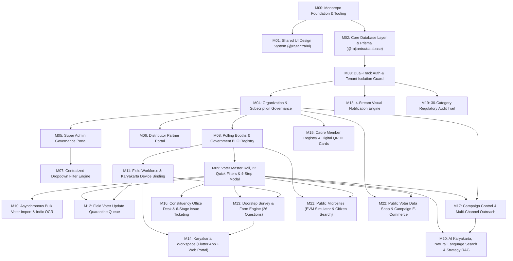

# Rajtantra: Module Implementation Roadmap
**Document Identifier:** `RAJ-ROA-MOD-001`  
**Version:** 1.0.0  
**Status:** Engineering Baseline (Ground Zero / Pre-Implementation)  
**Date:** October 2026  
**Platform Architecture:** Unified Multi-App Turborepo Monorepo & NestJS Modular Monolith

---

## 1. Executive Summary & Status Classification

This roadmap defines the end-to-end implementation specifications for all 22 functional modules comprising the **Rajtantra Election Management & Campaign Intelligence Ecosystem** across its **4 Role-Based Portals**, **2 Public Websites**, **3 Public Microsites**, and **Native Mobile Application**.

### Status Legend
- **Not started:** Requirements and architectural specs defined; zero code written.
- **In progress:** Active development stage (Requirements, Design, Database, Backend, Frontend, or Testing).
- **Implemented:** Code complete across backend and frontend; awaiting formal automated test execution.
- **Tested:** Unit, integration, security, and end-to-end tests passing with required coverage.
- **Approved:** Production-ready; verified against acceptance criteria and signed off by Lead Architect.

> **Current Repository Status:** All modules are currently **Not started**. The repository currently contains only documentation, design assets, and reference prototypes. No production application code has been generated.

---

## 2. Global Module Dependency Graph

---

## 3. Comprehensive Module Catalog

---

### Module 00: Monorepo Foundation & Tooling Infrastructure
- **Purpose:** Establish the monorepo workspace foundation, build orchestration, shared toolchain, and local containerized services cluster.
- **Portals Using It:** All portals and services (`web-candidate`, `web-superadmin`, `web-distributor`, `web-karyakarta`, `web-marketing`, `web-ecommerce`, `api-core`, `mobile-karyakarta`).
- **Features & User Workflows:**
  - Automated dependency resolution and pipeline caching via Turborepo and pnpm workspaces.
  - Multi-container local development stack: MySQL 8.0, Redis 7.0, MinIO object storage.
  - Shared TypeScript configurations (`@rajtantra/config-typescript`) and ESLint rules (`@rajtantra/config-eslint`).
- **Frontend Pages & Components:** None (tooling infrastructure).
- **Backend APIs & Business Services:** Docker healthcheck endpoints, root build and test scripts.
- **Database Tables & Relationships:** Container orchestration for MySQL 8.0 with utf8mb4 collation.
- **Required Permissions:** System / Developer level.
- **Dependencies:** None (Root prerequisite).
- **External Integrations:** Docker, pnpm, Turborepo.
- **Validation & Error Handling:** Node.js version verification (`>= 20.x`), strict lockfile enforcement.
- **Testing & Acceptance Criteria:**
  - `pnpm install` succeeds cleanly without peer dependency warnings.
  - `pnpm build` and `pnpm lint` succeed across all workspaces.
  - `docker compose up -d` brings up healthy MySQL, Redis, and MinIO instances.
- **Implementation Status:** **Not started**

---

### Module 01: Shared Design System & UI Primitive Library (`@rajtantra/ui`)
- **Purpose:** Provide a centralized, accessible, high-performance UI component library based on Tailwind CSS v4 and Shadcn UI, enforcing the solid-color design tokens documented in `Dummy_UI_SUper_admin.tsx`.
- **Portals Using It:** `web-candidate`, `web-superadmin`, `web-distributor`, `web-karyakarta`, `web-marketing`, `web-ecommerce`.
- **Features & User Workflows:**
  - Light and Dark mode theming using strictly solid CSS custom properties (no non-standard gradients).
  - High-density data tables with sticky headers, sorting, and pagination controls.
  - Reusable UI primitives: Buttons, Inputs, Modals/Dialogs, Dropdowns, Badges, Tabs, Skeletons, Filter Chips, Stat Cards.
  - 4-state standard visual presentation: Loading, Empty, Error, and Success.
- **Frontend Pages & Components:**
  - `DataTable`, `ModalDialog`, `MetricCard`, `StatusBadge`, `FilterChip`, `SkeletonLoader`, `ConfirmDialog`, `SidebarShell`, `HeaderShell`.
- **Backend APIs & Business Services:** None (UI package).
- **Database Tables & Relationships:** None.
- **Required Permissions:** Shared client-side library.
- **Dependencies:** `Module 00`.
- **External Integrations:** Tailwind CSS v4, Lucide React / Custom SVG icon registry.
- **Validation & Error Handling:** Accessible ARIA attributes, keyboard navigation traps, focus management.
- **Testing & Acceptance Criteria:**
  - Storybook / Component visual tests verify dark and light mode tokens.
  - WCAG 2.1 AA accessibility compliance across all primitive components.
- **Implementation Status:** **Not started**

---

### Module 02: Core Database Layer & Migrations (`@rajtantra/database`)
- **Purpose:** Maintain the single source of truth for all relational data models, schema migrations, and database access utilities via Prisma ORM.
- **Portals Using It:** `api-core`, migration CLI tools, seed scripts.
- **Features & User Workflows:**
  - Multi-tenant relational schema with composite indexes, foreign key constraints, and spatial indexes.
  - Automated Prisma client generation with row-level tenant extension (`organization_id` scoping).
  - Versioned migration files and idempotent database seeding scripts.
- **Frontend Pages & Components:** None.
- **Backend APIs & Business Services:** PrismaService database connection pool lifecycle manager.
- **Database Tables & Relationships:**
  - `organizations`, `users`, `roles`, `permissions`, `quotations`, `filter_groups`, `filter_options`, `notifications`, `office_visitors`, `issue_tickets`, `data_catalogue_items`, `data_purchases`, `vendors`, `marketplace_products`, `marketplace_orders`, `audit_logs`.
- **Required Permissions:** Database admin / application pool.
- **Dependencies:** `Module 00`.
- **External Integrations:** MySQL 8.0, Prisma ORM.
- **Validation & Error Handling:** Connection retry logic, dead-lock recovery, transaction rollbacks.
- **Testing & Acceptance Criteria:**
  - `prisma migrate dev` and `prisma migrate deploy` execute without errors.
  - Comprehensive schema validation tests verifying cascade rules and composite indexes.
- **Implementation Status:** **Not started**

---

### Module 03: Dual-Track Authentication, Authorization & Tenant Isolation
- **Purpose:** Secure platform access via two distinct authentication tracks: Web credentials with 2FA for administrators, and 6-character activation keys with hardware UUID binding for mobile field workers.
- **Portals Using It:** All portals and mobile applications.
- **Features & User Workflows:**
  - **Track A (Web):** Email/phone + bcrypt password login, TOTP 2FA verification, JWT access (15m) & refresh (7d) tokens, password recovery.
  - **Track B (Mobile/Field):** 6-character unique activation key + hardware UUID verification, device reset workflow, offline JWT caching.
  - Role-Based Access Control (RBAC) supporting 7 distinct roles: Super Admin, Distributor, Organization Owner, Admin, Manager/Editor, Worker/Karyakarta, Viewer.
  - Multi-tenant isolation: Automatic validation of `organization_id` from token against request payload/params.
- **Frontend Pages & Components:**
  - `/auth/login`, `/auth/register-enquiry`, `/auth/forgot-password`, `/auth/2fa`, `ActivationKeyScreen` (Mobile).
- **Backend APIs & Business Services:**
  - `POST /api/v1/auth/login`, `POST /api/v1/auth/refresh`, `POST /api/v1/auth/activate-karyakarta`, `POST /api/v1/auth/2fa/verify`, `POST /api/v1/auth/logout`.
  - Services: `AuthService`, `TokenService`, `DeviceBindingService`, `TenantIsolationGuard`, `RolesGuard`.
- **Database Tables & Relationships:** `users`, `karyakartas`, `user_sessions`, `refresh_tokens`.
- **Required Permissions:** Public endpoints for authentication; guarded routes require valid JWT and tenant match.
- **Dependencies:** `Module 00`, `Module 02`.
- **External Integrations:** TOTP (speakeasy), bcrypt, JWT.
- **Validation & Error Handling:** Rate limiting (5 failed attempts -> 15 min lock), Zod DTO schema validation, 401/403 custom exceptions.
- **Testing & Acceptance Criteria:**
  - Web login generates valid JWT with role claims; mobile activation binds hardware UUID.
  - Cross-tenant requests with tampered `organization_id` return 403 Forbidden.
  - Unit tests achieve > 90% coverage for auth service and security guards.
- **Implementation Status:** **Not started**

---

### Module 04: Organization & Subscription Governance
- **Purpose:** Manage candidate campaign organizations, administrative hierarchies, subscription lifecycles, and commercial terms.
- **Portals Using It:** `web-superadmin`, `web-distributor`, `web-candidate`.
- **Features & User Workflows:**
  - Candidate registration enquiry onboarding (decoupled from subscription purchase).
  - Two distinct subscription types: Office Module (6m/12m) and Election Module (until election date + 15 days).
  - 5-Day Free Trial automatic provisioning and expiration enforcement.
  - Global Pricing Visibility Switch: Super Admin toggles whether candidate portals see actual pricing or "Enquire Now".
  - Two-tier payment workflows: Direct candidate payment vs. Distributor settlement tracking.
- **Frontend Pages & Components:**
  - Candidate: `/organization`, `/organization/subscription`, `/organization/settings`.
  - Super Admin: `/admin/organizations`, `/admin/quotations`, `/admin/pricing-toggle`.
- **Backend APIs & Business Services:**
  - `GET /api/v1/organizations/:id`, `PATCH /api/v1/organizations/:id`, `POST /api/v1/organizations/register-enquiry`, `GET /api/v1/quotations`, `POST /api/v1/quotations`.
  - Services: `OrganizationService`, `SubscriptionService`, `QuotationService`, `PriceRedactionInterceptor`.
- **Database Tables & Relationships:** `organizations`, `quotations`, `payment_transactions`, `subscriptions`.
- **Required Permissions:** `SUPER_ADMIN`, `DISTRIBUTOR`, `ORGANIZATION_OWNER`.
- **Dependencies:** `Module 02`, `Module 03`.
- **External Integrations:** Razorpay / Cashfree webhooks.
- **Validation & Error Handling:** Strict validation of election dates and booth counts; API serializer redacts `price` fields when global switch is OFF.
- **Testing & Acceptance Criteria:**
  - Price redaction verified at API response envelope level when toggle is disabled.
  - Subscription validity correctly calculates "polling_date + 15 days" for election module.
- **Implementation Status:** **Not started**

---

### Module 05: Super Admin Governance Portal (`apps/web-superadmin`)
- **Purpose:** Platform owner console for global client management, distributor accounts, registration approvals, pricing toggles, and system audit logs.
- **Portals Using It:** `web-superadmin`.
- **Features & User Workflows:**
  - Platform dashboard with summary KPIs (Total Clients, Active Subscriptions, Demo Accounts, Total Voters Indexed).
  - Candidate account creation wizard (Organization -> Election Scope -> Language -> Assets).
  - Distributor management and commission configuration.
  - Quotation generation, payment verification, and manual service activation.
  - Centralized dropdown filter group manager.
  - Platform-wide audit trail viewer (30 activity categories).
- **Frontend Pages & Components:**
  - `/admin/dashboard`, `/admin/candidates`, `/admin/distributors`, `/admin/enquiries`, `/admin/filters`, `/admin/audit-logs`, `/admin/settings`.
  - Implemented based on `Dummy_UI_SUper_admin.tsx`.
- **Backend APIs & Business Services:**
  - `GET /api/v1/admin/stats`, `GET /api/v1/admin/candidates`, `POST /api/v1/admin/candidates`, `PATCH /api/v1/admin/candidates/:id/status`.
- **Database Tables & Relationships:** Global access to all tables.
- **Required Permissions:** `SUPER_ADMIN`.
- **Dependencies:** `Module 01`, `Module 03`, `Module 04`.
- **External Integrations:** Object storage (AWS S3) for client asset branding.
- **Validation & Error Handling:** Super Admin action confirmation dialogs for destructive actions.
- **Testing & Acceptance Criteria:**
  - Super Admin can provision a candidate and generate an activation license.
  - End-to-end audit logs record all Super Admin mutations.
- **Implementation Status:** **Not started**

---

### Module 06: Distributor / Channel Reseller Portal (`apps/web-distributor`)
- **Purpose:** Channel partner portal enabling approved distributors to onboard and manage candidate accounts, track wholesale commissions, and coordinate payment settlements.
- **Portals Using It:** `web-distributor`.
- **Features & User Workflows:**
  - Distributor dashboard displaying candidate pipeline, sales margins, and settlement status.
  - 12-Step Candidate Creation wizard tailored for distributor partner workflows.
  - Read-only tracking of candidate service enquiries.
  - Settlement ledger tracking candidate payments to distributor vs. distributor settlements with Super Admin.
- **Frontend Pages & Components:**
  - `/distributor/dashboard`, `/distributor/candidates`, `/distributor/candidates/new`, `/distributor/settlements`, `/distributor/profile`.
- **Backend APIs & Business Services:**
  - `GET /api/v1/distributor/candidates`, `POST /api/v1/distributor/candidates`, `GET /api/v1/distributor/settlements`.
- **Database Tables & Relationships:** `distributors`, `organizations`, `quotations`.
- **Required Permissions:** `DISTRIBUTOR`.
- **Dependencies:** `Module 01`, `Module 03`, `Module 04`.
- **External Integrations:** Payment invoice export.
- **Validation & Error Handling:** Distributor can view and manage only candidates assigned to their `distributor_id`.
- **Testing & Acceptance Criteria:**
  - Tenant query isolation prevents distributor from viewing candidates of other distributors.
  - Candidate creation wizard submits complete registration enquiry to Super Admin.
- **Implementation Status:** **Not started**

---

### Module 07: Centralized Dropdown Filter Engine (`api-core/filters`)
- **Purpose:** Allow Super Admin to dynamically manage dropdown taxonomies (caste categories, election types, occupation lists, issue categories) across all portals without redeploying code.
- **Portals Using It:** All portals and mobile clients.
- **Features & User Workflows:**
  - Super Admin creates filter groups and child options with English and local script labels.
  - Hierarchical parent-child options (e.g., State -> District -> Constituency).
  - In-memory Redis caching with cache invalidation on mutation.
- **Frontend Pages & Components:**
  - Super Admin: `/admin/filters`. Candidate Admin: Consumed across voter filter bars and profile dropdowns.
- **Backend APIs & Business Services:**
  - `GET /api/v1/filters/groups`, `GET /api/v1/filters/groups/:key/options`, `POST /api/v1/admin/filters/groups`, `POST /api/v1/admin/filters/options`.
  - Services: `FilterEngineService`, `FilterCacheService`.
- **Database Tables & Relationships:** `filter_groups`, `filter_options`.
- **Required Permissions:** Read: Authenticated users. Write: `SUPER_ADMIN`.
- **Dependencies:** `Module 02`, `Module 03`.
- **External Integrations:** Redis cache.
- **Validation & Error Handling:** Unique constraint on `group_key` and `option_key`, cascade soft-deletes.
- **Testing & Acceptance Criteria:**
  - Updating a caste category in Super Admin immediately reflects in Candidate Admin voter filter dropdowns via Redis cache invalidation.
- **Implementation Status:** **Not started**

---

### Module 08: Polling Booths & Government BLO Registry
- **Purpose:** Maintain the constituency polling station hierarchy, geographic coordinates, historical turnout stats, and government Booth Level Officer (BLO) directory.
- **Portals Using It:** `web-candidate`, `web-karyakarta`, `mobile-karyakarta`.
- **Features & User Workflows:**
  - Booth master directory with booth numbers, names, locations, and voter counts.
  - Government BLO directory mapped directly to polling stations with direct dial and WhatsApp shortcuts.
  - Booth-level historical election turnout comparison.
  - Export of booth directory and BLO contact book to Excel.
- **Frontend Pages & Components:**
  - `/booths`, `/booths/:id`, `/booths/new`, `/blo`, `/blo/:id`, `/blo/new`.
- **Backend APIs & Business Services:**
  - `GET /api/v1/booths`, `POST /api/v1/booths`, `GET /api/v1/blo`, `POST /api/v1/blo`.
  - Services: `BoothService`, `BloService`.
- **Database Tables & Relationships:** `booths`, `blo_records`, `organizations`.
- **Required Permissions:** `ORGANIZATION_OWNER`, `ADMIN`, `MANAGER`.
- **Dependencies:** `Module 02`, `Module 03`, `Module 04`.
- **External Integrations:** Google Maps Platform / Leaflet for booth geolocation.
- **Validation & Error Handling:** Unique `booth_number` per organization, phone number regex validation.
- **Testing & Acceptance Criteria:**
  - Booth creation and BLO assignment mapped with foreign key integrity.
  - Excel export generates formatted booth registry matching legacy templates.
- **Implementation Status:** **Not started**

---

### Module 09: Voter Master Roll, 22 Quick Filters & 4-Step Modal
- **Purpose:** The mission-critical core of Rajtantra: indexing 1M+ voters per constituency with sub-second multi-facet search, 22 quick filters, 4-step modal inspection, and 4-color sentiment tagging.
- **Portals Using It:** `web-candidate`, `web-karyakarta`, `mobile-karyakarta`.
- **Features & User Workflows:**
  - High-density virtualized Voter Directory rendering 500k+ voters without browser lag.
  - **22 Quick Filter Categories:**
    1. Alphabetical (A-Z)
    2. Age Groups (<25, 25-35, 36-50, 50-60, 60+)
    3. Gender (Male, Female, Other)
    4. Caste Category
    5. Color Code Sentiment (Green [Supporter], Blue [Neutral], Yellow [Doubtful], Red [Opponent])
    6. Booth Number / Polling Station
    7. Prabhaag / Sector
    8. Living / Residence Status
    9. Shifted / Migrated Status
    10. Duplicate Voter Flag
    11. Phone Available / Missing
    12. Visited / Unvisited Doorstep
    13. Government Scheme Beneficiary
    14. Occupation Category
    15. Family Head / Household Cluster
    16. Serial Number Range
    17. Section Number
    18. House Number
    19. Dead / Expired Flag
    20. First-Time Voter
    21. Influencer / Key Person Flag
    22. Survey Completed Status
  - **4-Step Voter Modal:**
    - Step 1: Electoral Identity (EPIC, Part, Serial, Section)
    - Step 2: Personal Profile & Demographics (Age, Gender, Caste, Education, Occupation)
    - Step 3: Work & Living Details (Address, Landmark, Shifted status, Living status)
    - Step 4: Political Alignment (Sentiment color code, Scheme benefits, Influence score)
  - One-tap 4-color sentiment tagging API updating voter status in real-time.
- **Frontend Pages & Components:**
  - `/voters`, `/voters/:id`, `/voters/new`, `/voters/:id/edit`.
  - Components: `VoterTableVirtual`, `QuickFilterBar`, `VoterProfileModal`, `SentimentColorPicker`, `VoterCard`.
- **Backend APIs & Business Services:**
  - `GET /api/v1/voters`, `GET /api/v1/voters/:id`, `POST /api/v1/voters`, `PATCH /api/v1/voters/:id/sentiment`, `GET /api/v1/voters/export`.
  - Services: `VotersService`, `VoterQueryBuilder`, `SentimentTaggingService`.
- **Database Tables & Relationships:** `voters`, `family_clusters`, `booths`, `organizations`.
- **Required Permissions:** Read/Update: `ORGANIZATION_OWNER`, `ADMIN`, `MANAGER`, `WORKER` (scoped).
- **Dependencies:** `Module 02`, `Module 03`, `Module 07`, `Module 08`.
- **External Integrations:** Redis caching for filter aggregates.
- **Validation & Error Handling:** Sanitized input, MySQL FULLTEXT search query escaping, sub-200ms query optimization.
- **Testing & Acceptance Criteria:**
  - Filtering 500,000 voter records returns first page results in < 200ms.
  - Sentiment update reflects immediately on both web and connected mobile clients.
- **Implementation Status:** **Not started**

---

### Module 10: Asynchronous Bulk Voter Import & Indic OCR Pipeline
- **Purpose:** Process high-volume PDF electoral rolls (> 10,000 PDF batches) and bulk Excel/CSV datasets into structured voter records.
- **Portals Using It:** `web-candidate`, `web-superadmin`.
- **Features & User Workflows:**
  - Asynchronous background job queue powered by BullMQ and Redis.
  - Devanagari and English Indic OCR extraction (EasyOCR & PyTesseract) with low-confidence quarantine flag.
  - Multi-stage CSV/Excel voter import with column mapping wizard and duplicate detection.
  - Progress bar with real-time WebSocket job status updates.
- **Frontend Pages & Components:**
  - `/voters/import`, `/operations/ocr`, `/operations/jobs`.
- **Backend APIs & Business Services:**
  - `POST /api/v1/voters/import-upload`, `POST /api/v1/voters/import-process`, `GET /api/v1/jobs/:id/status`.
  - Services: `VoterImportWorker`, `OcrJobService`, `DuplicateDetectionService`.
- **Database Tables & Relationships:** `import_jobs`, `ocr_batches`, `voters`.
- **Required Permissions:** `ORGANIZATION_OWNER`, `ADMIN`.
- **Dependencies:** `Module 09`, BullMQ, Redis.
- **External Integrations:** Python AI/OCR Microservice (`service-ai-ocr`), MinIO storage.
- **Validation & Error Handling:** File size limits (max 100MB), chunked parsing (1,000 records/batch), error summary log export.
- **Testing & Acceptance Criteria:**
  - Bulk import of 10,000 voter rows completes in < 30 seconds with 100% data integrity.
  - Invalid records flagged in quarantine report without crashing the batch.
- **Implementation Status:** **Not started**

---

### Module 11: Field Workforce & Karyakarta Device Binding
- **Purpose:** Manage field volunteers, generate unique activation credentials, enforce geographical and serial number constraints, and monitor real-time GPS telemetry.
- **Portals Using It:** `web-candidate`, `web-karyakarta`, `mobile-karyakarta`.
- **Features & User Workflows:**
  - Worker directory with assigned Prabhaag, Booths, and Serial Number range constraints.
  - 6-character Unique Activation Key generation with QR code.
  - Hardware device UUID binding upon first mobile login; one-click Admin Device Reset workflow.
  - Live GPS heartbeat tracking displaying worker routes on an interactive War Room map.
- **Frontend Pages & Components:**
  - `/users`, `/users/new`, `/users/:id`, `/field-map` (War Room Live Map).
- **Backend APIs & Business Services:**
  - `GET /api/v1/karyakartas`, `POST /api/v1/karyakartas`, `POST /api/v1/karyakartas/:id/reset-device`, `POST /api/v1/karyakartas/telemetry`.
  - Services: `KaryakartaService`, `DeviceBindingService`, `GpsTelemetryService`.
- **Database Tables & Relationships:** `karyakartas`, `worker_booth_assignments`, `worker_telemetry`, `organizations`.
- **Required Permissions:** `ORGANIZATION_OWNER`, `ADMIN`.
- **Dependencies:** `Module 03`, `Module 08`.
- **External Integrations:** Mapbox / Leaflet for Live Field Map.
- **Validation & Error Handling:** Prevents duplicate active device bindings; validates latitude/longitude bounds.
- **Testing & Acceptance Criteria:**
  - Field worker attempting login on a secondary phone is blocked until Admin triggers device reset.
  - Telemetry updates record valid GPS tracks displayed accurately on War Room map.
- **Implementation Status:** **Not started**

---

### Module 12: Field Voter Update Quarantine Queue
- **Purpose:** Prevent corrupt or malicious data from overwriting the official electoral roll by quarantining field worker modifications for human-in-the-loop Candidate Admin approval.
- **Portals Using It:** `web-candidate`.
- **Features & User Workflows:**
  - Ground workers submit voter edits (phone number, shifted status, living status, address notes) from the field.
  - Edits enter the Quarantine Queue instead of directly updating the master record.
  - Candidate Admin inspects a side-by-side Before/After JSON diff screen.
  - One-click Approve or Reject with optional rejection reason.
- **Frontend Pages & Components:**
  - `/update-requests`, `/update-requests/:id`.
  - Components: `BeforeAfterDiffViewer`, `QuarantineQueueTable`, `BatchApproveBar`.
- **Backend APIs & Business Services:**
  - `GET /api/v1/update-requests`, `POST /api/v1/update-requests/:id/approve`, `POST /api/v1/update-requests/:id/reject`.
  - Services: `VoterUpdateQueueService`, `MasterVoterSyncService`.
- **Database Tables & Relationships:** `voter_update_requests`, `voters`, `karyakartas`.
- **Required Permissions:** Review/Approve: `ORGANIZATION_OWNER`, `ADMIN`. Submit: `WORKER`.
- **Dependencies:** `Module 09`, `Module 11`.
- **External Integrations:** None.
- **Validation & Error Handling:** Strict JSON schema validation of proposed changes; atomicity when applying approved diffs.
- **Testing & Acceptance Criteria:**
  - Approved update immediately applies changes to master `voters` table with audit log entry.
  - Rejected update leaves master record untouched and records rejection reason.
- **Implementation Status:** **Not started**

---

### Module 13: Doorstep Survey & Dynamic Form Engine (26 Questions)
- **Purpose:** Design and conduct dynamic field surveys (including the standardized 26-question election survey) with tamper-proof GPS geo-verification and live cross-tabulation analytics.
- **Portals Using It:** `web-candidate`, `web-karyakarta`, `mobile-karyakarta`.
- **Features & User Workflows:**
  - Dynamic form builder supporting single-choice, multiple-choice, rating, and open text questions.
  - Pre-configured standardized 26-question Indian election doorstep survey.
  - GPS anti-tamper enforcement: Capture device GPS coordinates (<25m accuracy) and device timestamp upon submission to prevent worker falsification.
  - War Room survey analytics: Cross-tabulation by booth, caste, age group, and sentiment.
- **Frontend Pages & Components:**
  - Web: `/forms`, `/forms/new`, `/forms/:id`, `/forms/:id/analytics`, `/forms/:id/responses`.
  - Mobile: `SurveyExecutionScreen`, `QuestionCardStepper`.
- **Backend APIs & Business Services:**
  - `GET /api/v1/surveys`, `POST /api/v1/surveys`, `POST /api/v1/surveys/:id/responses`, `GET /api/v1/surveys/:id/analytics`.
  - Services: `SurveyEngineService`, `GeoVerificationService`, `SurveyAnalyticsService`.
- **Database Tables & Relationships:** `survey_forms`, `survey_questions`, `survey_responses`, `voters`.
- **Required Permissions:** Administer: `ADMIN`. Execute: `WORKER`.
- **Dependencies:** `Module 09`, `Module 11`.
- **External Integrations:** Device GPS hardware.
- **Validation & Error Handling:** Rejects survey submissions with GPS accuracy > 50 meters or mismatched booth polygon bounds.
- **Testing & Acceptance Criteria:**
  - Survey responses accurately link to `voter_id` and worker `karyakarta_id`.
  - Aggregation engine computes question percentages across 100,000 responses in < 500ms.
- **Implementation Status:** **Not started**

---

### Module 14: Karyakarta Workspace (Dual Delivery: Flutter App + Dedicated Web Portal)
- **Purpose:** Provide ground field volunteers with high-speed offline tools for door-to-door canvassing, sub-50ms voter lookup, 4-color sentiment tagging, survey execution, and Bluetooth thermal slip printing.
- **Portals Using It:** `apps/mobile-karyakarta` (Flutter) and `apps/web-karyakarta` (Next.js).
- **Features & User Workflows:**
  - **Flutter Mobile App:**
    - Activation key login and local encrypted SQLite database (Drift).
    - Sub-50ms offline voter search by name, house number, or serial number.
    - 4-color sentiment tagging (Green, Blue, Yellow, Red) and direct calling/WhatsApp actions.
    - Doorstep survey execution with GPS anti-tamper validation.
    - Bluetooth ESC/POS thermal printer driver (58mm/80mm) for instant polling day voter slips.
    - Background sync queue synchronizing pending surveys and tags when internet restores.
  - **Dedicated Karyakarta Web Portal:**
    - Identical operational capabilities designed for desktop/laptop volunteers stationed at campaign offices.
- **Frontend Pages & Components:**
  - Mobile: `DashboardScreen`, `VoterSearchScreen`, `VoterDetailScreen`, `SurveyScreen`, `PrinterSettingsScreen`.
  - Web: `/karyakarta/dashboard`, `/karyakarta/voters`, `/karyakarta/surveys`.
- **Backend APIs & Business Services:**
  - `GET /api/v1/karyakarta/booth-data`, `POST /api/v1/karyakarta/sync-batch`.
- **Database Tables & Relationships:** `karyakartas`, `voters`, `survey_responses`, local Drift SQLite.
- **Required Permissions:** `WORKER`.
- **Dependencies:** `Module 03`, `Module 09`, `Module 11`, `Module 13`.
- **External Integrations:** Bluetooth thermal receipt printers (ESC/POS protocol), FCM push notifications.
- **Validation & Error Handling:** Conflict resolution on offline sync (server timestamp priority); graceful Bluetooth connection retry.
- **Testing & Acceptance Criteria:**
  - Voter search executes in < 50ms completely offline on mobile device.
  - Bluetooth thermal slip prints valid barcode and voter details in < 3 seconds.
- **Implementation Status:** **Not started**

---

### Module 15: Cadre Member Registry & Digital ID Generator
- **Purpose:** Onboard party volunteers and cadre members, maintain the organizational directory, and generate branded digital QR-coded ID card PDFs.
- **Portals Using It:** `web-candidate`, public volunteer onboarding link.
- **Features & User Workflows:**
  - Public branded registration link for cadre volunteers.
  - Candidate Admin review and membership approval workflow.
  - Dynamic generation of print-ready PDF membership cards with candidate branding, member photo, and verification QR code.
- **Frontend Pages & Components:**
  - `/members`, `/members/new`, `/members/registrations`, `/members/registration-link`.
- **Backend APIs & Business Services:**
  - `GET /api/v1/members`, `POST /api/v1/members`, `POST /api/v1/members/:id/generate-card`.
  - Services: `MemberService`, `PdfCardGeneratorService`.
- **Database Tables & Relationships:** `cadre_members`, `organizations`.
- **Required Permissions:** `ORGANIZATION_OWNER`, `ADMIN`.
- **Dependencies:** `Module 02`, `Module 03`, `Module 04`.
- **External Integrations:** PDFKit / Puppeteer for vector PDF ID card rendering.
- **Validation & Error Handling:** Member mobile uniqueness per organization, photo size/format validation.
- **Testing & Acceptance Criteria:**
  - Generated ID card renders correct photo, QR code, and party colors in vector PDF format.
  - Scanning ID card QR code resolves to verified member confirmation URL.
- **Implementation Status:** **Not started**

---

### Module 16: Constituency Office Desk & 6-Stage Issue Ticketing
- **Purpose:** Digitize the candidate's physical constituency office with visitor reception desk, fuzzy matching against voter records, and a 6-stage civic issue ticketing lifecycle.
- **Portals Using It:** `web-candidate`.
- **Features & User Workflows:**
  - Office visitor intake desk capturing visitor name, contact, purpose, and timestamp.
  - Real-time fuzzy search matching incoming visitors to existing voter records (with unmatched visitor profile creation).
  - 6-Stage Civic Issue Lifecycle: `NEW` -> `ASSIGNED` -> `IN_PROGRESS` -> `FOLLOW_UP` -> `RESOLVED` -> `CLOSED`.
  - Categorization across civic areas: Water, Electricity, Road, Scheme, Ration, Pension.
  - Automated WhatsApp/SMS status updates sent to citizens upon ticket stage change.
- **Frontend Pages & Components:**
  - `/office/visitors`, `/office/visitors/new`, `/office/tickets`, `/office/tickets/:id`.
- **Backend APIs & Business Services:**
  - `GET /api/v1/office/visitors`, `POST /api/v1/office/visitors`, `GET /api/v1/office/tickets`, `PATCH /api/v1/office/tickets/:id/status`.
  - Services: `OfficeDeskService`, `IssueTicketService`, `FuzzyVoterMatcher`.
- **Database Tables & Relationships:** `office_visitors`, `issue_tickets`, `voters`, `organizations`.
- **Required Permissions:** `ORGANIZATION_OWNER`, `ADMIN`, `MANAGER`.
- **Dependencies:** `Module 02`, `Module 03`, `Module 09`.
- **External Integrations:** WhatsApp notification webhook triggers.
- **Validation & Error Handling:** Auto-generated unique ticket number sequence (`TCK-YYYY-XXXXX`).
- **Testing & Acceptance Criteria:**
  - Changing ticket status to `RESOLVED` triggers resolution timestamp and audit trail.
  - Fuzzy matcher identifies potential voter match based on name and mobile number.
- **Implementation Status:** **Not started**

---

### Module 17: Campaign Control & Multi-Channel Outreach
- **Purpose:** Execute targeted voter communication via official Meta WhatsApp Business Cloud API, DLT-compliant SMS, automated Birthday Wishes, and RinggAI voice bot batches.
- **Portals Using It:** `web-candidate`.
- **Features & User Workflows:**
  - Automated Daily Birthday Wishes scheduler sending personalized WhatsApp/SMS greetings.
  - Targeted bulk campaign builder filtering recipients via the 22 quick filter engine.
  - Integration with official Meta WhatsApp Cloud API for template message dispatches.
  - Integration with RinggAI for autonomous voice broadcast calls.
  - Consumable credit balance monitoring and recharge requests.
- **Frontend Pages & Components:**
  - `/campaigns`, `/campaigns/new`, `/campaigns/birthday`, `/campaigns/voice`, `/campaigns/credits`.
- **Backend APIs & Business Services:**
  - `POST /api/v1/campaigns/whatsapp`, `POST /api/v1/campaigns/sms`, `POST /api/v1/campaigns/voice`, `GET /api/v1/campaigns/credits`.
  - Services: `OutreachService`, `WhatsAppCloudService`, `DltSmsService`, `RinggAiService`, `BirthdayCronJob`.
- **Database Tables & Relationships:** `campaigns`, `campaign_messages`, `credit_ledger`, `organizations`.
- **Required Permissions:** `ORGANIZATION_OWNER`, `ADMIN`.
- **Dependencies:** `Module 04`, `Module 09`, Redis, BullMQ.
- **External Integrations:** Meta WhatsApp Cloud API, DLT SMS Gateway, RinggAI Voice API.
- **Validation & Error Handling:** Verification of sufficient credit balance prior to dispatch; DLT template ID verification.
- **Testing & Acceptance Criteria:**
  - Daily birthday scheduler executes at 08:00 AM local time and dispatches greetings to matching voters.
  - Campaign batch honors rate limits without dropping queued messages.
- **Implementation Status:** **Not started**

---

### Module 18: 4-Stream Visual Notification Engine
- **Purpose:** Power the platform notification system with 4 distinct visual categories distinguished by dedicated header banners, and dispatch in-app and push alerts.
- **Portals Using It:** All portals and mobile clients.
- **Features & User Workflows:**
  - **Stream 1: System Notifications (Neutral White Banner):** Operational alerts, account approvals, subscription expiry (`SYS-01` to `SYS-54`).
  - **Stream 2: Engagement Notifications (Cyan-Blue Banner):** Feature walkthroughs, survey prompts (`ENG-01` to `ENG-13`).
  - **Stream 3: Strategic Intelligence Notifications (Light-Red Banner):** AI operational insights, low turnout alerts (`INT-01` to `INT-25`).
  - **Stream 4: Candidate Admin Notifications (Purple Banner):** Manual candidate directives sent to field karyakartas (`ADM-01` to `ADM-10`).
  - Web notification drawer with unread badges; mobile FCM push notifications.
- **Frontend Pages & Components:**
  - `NotificationDrawer`, `NotificationBannerCard`, `NotificationBellBadge`.
- **Backend APIs & Business Services:**
  - `GET /api/v1/notifications`, `PATCH /api/v1/notifications/:id/read`, `POST /api/v1/notifications/broadcast`.
  - Services: `NotificationEngineService`, `FcmPushService`.
- **Database Tables & Relationships:** `notifications`, `users`, `karyakartas`, `organizations`.
- **Required Permissions:** Read: All authenticated users. Broadcast: `SUPER_ADMIN`, `ORGANIZATION_OWNER`.
- **Dependencies:** `Module 02`, `Module 03`.
- **External Integrations:** Firebase Cloud Messaging (FCM).
- **Validation & Error Handling:** Enum validation for `category` and `banner_color`; template code verification.
- **Testing & Acceptance Criteria:**
  - Correct banner color rendered based on category enum.
  - Marking notification as read updates database state and decrements unread counter.
- **Implementation Status:** **Not started**

---

### Module 19: Comprehensive 30-Category Regulatory Audit Trail
- **Purpose:** Maintain an immutable, tamper-evident regulatory audit log capturing all 30 distinct system activity categories across all user actions.
- **Portals Using It:** `web-superadmin`, `web-candidate`.
- **Features & User Workflows:**
  - Interceptor automatically recording mutations across all 30 system activity categories.
  - Detailed capture: Actor ID, role, tenant ID, entity modified, before/after JSON diff, timestamp, and IP address.
  - Searchable audit log viewer with role and date filters.
  - Tamper-evident architecture (append-only log entries; updates and deletions strictly blocked).
- **Frontend Pages & Components:**
  - Super Admin: `/admin/audit-logs`. Candidate Admin: `/activities`.
- **Backend APIs & Business Services:**
  - `GET /api/v1/audit-logs`, `GET /api/v1/audit-logs/:id`.
  - Interceptor: `AuditLogInterceptor`. Service: `AuditLogService`.
- **Database Tables & Relationships:** `audit_logs`, `organizations`, `users`.
- **Required Permissions:** `SUPER_ADMIN`, `ORGANIZATION_OWNER`.
- **Dependencies:** `Module 02`, `Module 03`.
- **External Integrations:** None.
- **Validation & Error Handling:** Asynchronous logging without impacting main API response latency.
- **Testing & Acceptance Criteria:**
  - Any voter update, user creation, or permission change appends a structured record in `audit_logs`.
  - Direct database attempt to delete an audit log row throws foreign key / trigger violation.
- **Implementation Status:** **Not started**

---

### Module 20: AI Assistant, Natural Language Search & Strategy RAG
- **Purpose:** Provide an agentic AI digital karyakarta, natural-language-to-SQL query translation, natural-language report synthesis, and vector-based historical election strategy intelligence.
- **Portals Using It:** `web-candidate`, `mobile-karyakarta`.
- **Features & User Workflows:**
  - **AI Mode (Digital Assistant):** Chatbot with strict backend tool-calling accessing voter counts and booth performance.
  - **AI Query Search:** Converts natural language (English/Hindi/Marathi) into 22 quick filter structured JSON.
  - **AI Report Generator:** Generates downloadable Excel/PDF reports from conversational prompts.
  - **Strategy Bot (RAG):** Answers strategic queries by querying historical election manifestos and booth results indexed in Qdrant vector database.
  - Human-in-the-loop safety guardrails preventing hallucinated writes or unapproved dispatches.
- **Frontend Pages & Components:**
  - `/ai-mode`, `AiQuerySearchBar`, `AiStrategyChatDrawer`.
- **Backend APIs & Business Services:**
  - `POST /api/v1/ai/query-parse`, `POST /api/v1/ai/chat`, `POST /api/v1/ai/generate-report`.
  - Services: `AiGatewayService`, `TextToSqlParser`, `RagStrategyService`.
- **Database Tables & Relationships:** `ai_conversations`, `ai_seat_allocations`, Qdrant vector collections.
- **Required Permissions:** Active subscription with `has_ai_mode = true` and assigned AI seat.
- **Dependencies:** `Module 04`, `Module 09`, `service-ai-ocr`, Qdrant Vector DB.
- **External Integrations:** Google Gemini API / OpenAI API, Qdrant Vector DB.
- **Validation & Error Handling:** Read-only SQL execution bounds; strict JSON schema validation of parsed filters.
- **Testing & Acceptance Criteria:**
  - Natural language prompt "Show all Muslim women aged 25 to 35 in Booth 14" produces correct structured filter JSON.
  - Unauthorized user without AI seat is blocked with 403 Payment Required.
- **Implementation Status:** **Not started**

---

### Module 21: Public Electoral Microsites & Citizen Tools
- **Purpose:** Deliver branded public-facing tools: interactive EVM ballot simulator, ECI-compliant citizen voter search landing page, and candidate campaign showcase.
- **Portals Using It:** Public web tier (`subdomain.rajtantra.in`).
- **Features & User Workflows:**
  - **Public EVM Demo Simulator:** Realistic interactive voting machine replica with tactile sounds, LED indicator lights, candidate symbols, and custom candidate subdomains.
  - **Public Citizen Voter Search:** Branded public voter search portal. **Strict Rule:** Supports **Name Search ONLY** (no EPIC, mobile, or house number search) to strictly comply with ECI citizen privacy rules. Generates printable slip download.
- **Frontend Pages & Components:**
  - `/evm-simulator`, `/voter-search`, `/candidate-profile`.
- **Backend APIs & Business Services:**
  - `GET /api/v1/public/evm/:subdomain`, `GET /api/v1/public/voter-search`.
- **Database Tables & Relationships:** `organizations`, `voters` (redacted view), `booths`.
- **Required Permissions:** Public / Unauthenticated (rate-limited by IP).
- **Dependencies:** `Module 04`, `Module 08`, `Module 09`.
- **External Integrations:** Cloudflare edge caching, audio web APIs.
- **Validation & Error Handling:** Rate limiting (max 10 lookups per minute per IP), CAPTCHA challenge.
- **Testing & Acceptance Criteria:**
  - EVM simulator plays realistic beep sound upon voter selection and locks ballot for 2 seconds.
  - Citizen search returns name and booth info only; strictly redacts phone numbers and EPIC details.
- **Implementation Status:** **Not started**

---

### Module 22: Public Voter Data Marketplace & E-Commerce Campaign Merchandise Store
- **Purpose:** Monetize official voter roll datasets through a location-based data shop, and run an e-commerce campaign merchandise marketplace for election supplies.
- **Portals Using It:** `apps/web-marketing` and `apps/web-ecommerce`.
- **Features & User Workflows:**
  - **Public Voter Data Shop:**
    - Browse official voter lists: State -> District -> Constituency -> Booth.
    - Verified record counts and instant price calculation.
    - Payment checkout yielding time-limited secure Excel/CSV download token.
  - **Campaign Products Marketplace:**
    - Multi-vendor campaign merchandise store (caps, flags, banners, posters, audio gear).
    - Vendor onboarding, Super Admin approval, product catalog, cart/checkout, vendor commission tracking.
- **Frontend Pages & Components:**
  - `/voter-data-shop`, `/voter-data-shop/checkout`, `/marketplace`, `/marketplace/cart`, `/vendor/portal`.
- **Backend APIs & Business Services:**
  - `GET /api/v1/catalog/items`, `POST /api/v1/catalog/purchase`, `GET /api/v1/ecommerce/products`, `POST /api/v1/ecommerce/orders`.
- **Database Tables & Relationships:** `data_catalogue_items`, `data_purchases`, `vendors`, `marketplace_products`, `marketplace_orders`.
- **Required Permissions:** Public / Buyer; Vendor portal requires `VENDOR` role.
- **Dependencies:** `Module 02`, `Module 04`, Razorpay/Cashfree.
- **External Integrations:** Razorpay/Cashfree payment gateway, cloud storage pre-signed URLs.
- **Validation & Error Handling:** Download tokens expire in 24 hours; order stock validation.
- **Testing & Acceptance Criteria:**
  - Verified payment immediately generates single-use download token for voter data dataset.
  - Vendor order settlement accurately credits platform sales commission.
- **Implementation Status:** **Not started**

---

## 4. Implementation Phasing & Status Summary Table

| Phase | Module ID & Title | Primary Portals | Dependencies | Target Coverage | Status |
|:---:|---|---|---|:---:|:---:|
| **P01** | **M00: Monorepo Foundation & Tooling** | All workspaces | None | Smoke | **Not started** |
| **P02** | **M01: Shared UI Design System** | `@rajtantra/ui` | M00 | Visual Tests | **Not started** |
| **P03** | **M02: Core Database Layer & Prisma** | `@rajtantra/database` | M00 | 100% Schema | **Not started** |
| **P04** | **M03: Dual-Track Auth & Tenant Isolation** | `api-core`, Web & Mobile | M00, M02 | > 90% | **Not started** |
| **P05** | **M04: Organization & Subscription** | `api-core`, Super Admin | M02, M03 | > 85% | **Not started** |
| **P06** | **M05: Super Admin Governance Portal** | `web-superadmin` | M01, M03, M04 | E2E Happy | **Not started** |
| **P07** | **M06: Distributor Partner Portal** | `web-distributor` | M01, M03, M04 | E2E Happy | **Not started** |
| **P08** | **M07: Centralized Dropdown Filter Engine** | `api-core`, All Portals | M02, M03 | > 85% | **Not started** |
| **P09** | **M08: Polling Booths & BLO Registry** | `api-core`, War Room | M02, M03, M04 | > 85% | **Not started** |
| **P10** | **M09: Voter Master Roll & 22 Filters** | `web-candidate`, `api-core` | M02, M03, M07, M08 | > 85% | **Not started** |
| **P11** | **M10: Asynchronous Import & Indic OCR** | `service-ai-ocr`, BullMQ | M09 | > 80% | **Not started** |
| **P12** | **M11: Field Workforce & Device Binding** | `web-candidate`, `api-core` | M03, M08 | > 85% | **Not started** |
| **P13** | **M12: Field Voter Update Quarantine** | `web-candidate`, `api-core` | M09, M11 | > 85% | **Not started** |
| **P14** | **M13: Doorstep Survey & Form Engine** | `web-candidate`, Mobile | M09, M11 | > 85% | **Not started** |
| **P15** | **M14: Karyakarta Workspace (Mobile+Web)** | `mobile-karyakarta`, Web | M03, M09, M11, M13 | > 80% | **Not started** |
| **P16** | **M15: Cadre Member Registry & QR Cards** | `web-candidate`, Public | M02, M03, M04 | > 80% | **Not started** |
| **P17** | **M16: Constituency Office & Issue Tickets**| `web-candidate`, `api-core` | M02, M03, M09 | > 85% | **Not started** |
| **P18** | **M17: Campaign Control & Outreach** | `web-candidate`, `api-core` | M04, M09, BullMQ | > 80% | **Not started** |
| **P19** | **M18: 4-Stream Visual Notification Engine**| `api-core`, All Portals | M02, M03 | > 85% | **Not started** |
| **P20** | **M19: 30-Category Regulatory Audit Trail** | `api-core`, Super Admin | M02, M03 | > 90% | **Not started** |
| **P21** | **M20: AI Karyakarta, Search & RAG** | `service-ai-ocr`, `api-core` | M04, M09, Qdrant | > 80% | **Not started** |
| **P22** | **M21: Public Microsites (EVM & Citizen)** | Public Web Tier | M04, M08, M09 | E2E Happy | **Not started** |
| **P23** | **M22: Voter Data Shop & E-Commerce** | `web-marketing`, `web-ecomm`| M02, M04 | E2E Happy | **Not started** |

---
*End of Module Implementation Roadmap.*
