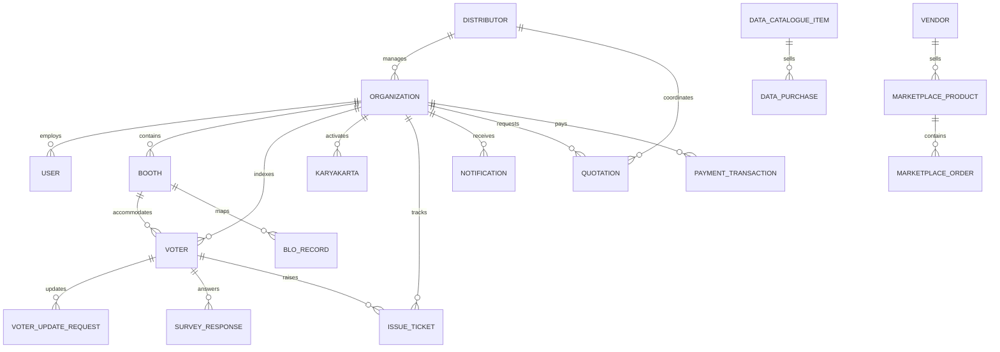

# Rajtantra: Relational Database Architecture & Schema Specification
**Document Identifier:** `RAJ-DB-003`  
**Version:** 2.0.0 (Updated post-`portals` audit)  
**Status:** Architecture Baseline (Phase 1 Approved)  
**Date:** October 2026  

---

## 1. Database Philosophy & Extended Multi-Tenant Isolation

Rajtantra manages high-volume voter lists (> 2M rows per constituency), candidate field operations, physical e-commerce merchandise, public voter datasets, and multi-stream notification logs.



---

## 2. Core Relational Schema (Updated DDL)

### 2.1 Quotations & Commercial Terms (`quotations`)
Stores customized agreed pricing, independent of standard price changes:
```sql
CREATE TABLE quotations (
    id VARCHAR(36) PRIMARY KEY,
    organization_id VARCHAR(36) NOT NULL,
    distributor_id VARCHAR(36) NULL,
    request_type ENUM('SUBSCRIPTION_OFFICE', 'SUBSCRIPTION_ELECTION', 'RECHARGE_CAMPAIGN', 'DATA_SERVICE', 'EXTRA_SERVICE') NOT NULL,
    module_type ENUM('OFFICE_6M', 'OFFICE_12M', 'ELECTION_MODULE') NULL,
    has_ai_mode BOOLEAN DEFAULT FALSE,
    standard_price DECIMAL(10,2) NOT NULL,
    quoted_price DECIMAL(10,2) NOT NULL,
    distributor_commission DECIMAL(10,2) DEFAULT 0.00,
    distributor_settlement_amount DECIMAL(10,2) DEFAULT 0.00,
    valid_until DATE,
    status ENUM('DRAFT', 'SHARED', 'ACCEPTED', 'REJECTED', 'EXPIRED') DEFAULT 'SHARED',
    created_by_admin_id VARCHAR(36) NOT NULL,
    created_at TIMESTAMP DEFAULT CURRENT_TIMESTAMP,
    FOREIGN KEY (organization_id) REFERENCES organizations(id) ON DELETE CASCADE,
    FOREIGN KEY (distributor_id) REFERENCES distributors(id) ON DELETE SET NULL,
    INDEX idx_quotations_org (organization_id, status)
) ENGINE=InnoDB DEFAULT CHARSET=utf8mb4 COLLATE=utf8mb4_unicode_ci;
```

### 2.2 Centralized Dropdown Filter Management (`filter_groups`, `filter_options`)
Enables Super Admin to update dropdown taxonomies across all portals without redeploying code:
```sql
CREATE TABLE filter_groups (
    id VARCHAR(36) PRIMARY KEY,
    group_key VARCHAR(50) UNIQUE NOT NULL, -- e.g. 'caste_categories', 'election_types'
    group_name VARCHAR(100) NOT NULL,
    category VARCHAR(50) NOT NULL,
    is_active BOOLEAN DEFAULT TRUE,
    created_at TIMESTAMP DEFAULT CURRENT_TIMESTAMP
) ENGINE=InnoDB DEFAULT CHARSET=utf8mb4 COLLATE=utf8mb4_unicode_ci;

CREATE TABLE filter_options (
    id VARCHAR(36) PRIMARY KEY,
    group_id VARCHAR(36) NOT NULL,
    option_key VARCHAR(50) NOT NULL,
    option_label_en VARCHAR(100) NOT NULL,
    option_label_local VARCHAR(100),
    parent_option_id VARCHAR(36) NULL, -- For dependent dropdowns (State -> Dist -> Const)
    display_order INT DEFAULT 0,
    is_active BOOLEAN DEFAULT TRUE,
    FOREIGN KEY (group_id) REFERENCES filter_groups(id) ON DELETE CASCADE,
    FOREIGN KEY (parent_option_id) REFERENCES filter_options(id) ON DELETE SET NULL,
    INDEX idx_filter_opt_group (group_id, is_active, display_order)
) ENGINE=InnoDB DEFAULT CHARSET=utf8mb4 COLLATE=utf8mb4_unicode_ci;
```

### 2.3 Comprehensive Notification Engine (`notifications`)
Stores the 4 notification streams with distinct visual banners:
```sql
CREATE TABLE notifications (
    id VARCHAR(36) PRIMARY KEY,
    organization_id VARCHAR(36) NOT NULL,
    recipient_user_id VARCHAR(36) NULL,        -- NULL denotes all karyakartas in org
    category ENUM('SYSTEM', 'ENGAGEMENT', 'STRATEGIC_INTELLIGENCE', 'CANDIDATE_ADMIN') NOT NULL,
    banner_color ENUM('NEUTRAL_WHITE', 'CYAN_BLUE', 'LIGHT_RED', 'PURPLE') NOT NULL,
    template_code VARCHAR(30) NOT NULL,        -- e.g. 'SYS-01', 'ENG-04', 'INT-12'
    title VARCHAR(150) NOT NULL,
    message TEXT NOT NULL,
    target_route VARCHAR(255),                 -- Internal app route to navigate to
    is_read BOOLEAN DEFAULT FALSE,
    read_at TIMESTAMP NULL,
    created_at TIMESTAMP DEFAULT CURRENT_TIMESTAMP,
    FOREIGN KEY (organization_id) REFERENCES organizations(id) ON DELETE CASCADE,
    INDEX idx_notif_user_read (recipient_user_id, is_read),
    INDEX idx_notif_org_cat (organization_id, category)
) ENGINE=InnoDB DEFAULT CHARSET=utf8mb4 COLLATE=utf8mb4_unicode_ci;
```

### 2.4 Office Visitor & Issue Tickets (`office_visitors`, `issue_tickets`)
Constituency office visitor desk with fuzzy search matching and 6-stage issue ticket lifecycle:
```sql
CREATE TABLE office_visitors (
    id VARCHAR(36) PRIMARY KEY,
    organization_id VARCHAR(36) NOT NULL,
    voter_id VARCHAR(36) NULL,                 -- NULL if unmatched visitor
    visitor_name VARCHAR(150) NOT NULL,
    mobile VARCHAR(20) NOT NULL,
    address TEXT,
    purpose TEXT NOT NULL,
    visited_at TIMESTAMP DEFAULT CURRENT_TIMESTAMP,
    attended_by_user_id VARCHAR(36) NOT NULL,
    FOREIGN KEY (organization_id) REFERENCES organizations(id) ON DELETE CASCADE,
    FOREIGN KEY (voter_id) REFERENCES voters(id) ON DELETE SET NULL,
    INDEX idx_visitors_org (organization_id, visited_at)
) ENGINE=InnoDB DEFAULT CHARSET=utf8mb4 COLLATE=utf8mb4_unicode_ci;

CREATE TABLE issue_tickets (
    id VARCHAR(36) PRIMARY KEY,
    organization_id VARCHAR(36) NOT NULL,
    ticket_number VARCHAR(30) UNIQUE NOT NULL, -- e.g. "TCK-2026-00124"
    voter_id VARCHAR(36) NULL,
    visitor_id VARCHAR(36) NULL,
    category VARCHAR(100) NOT NULL,            -- Water, Electricity, Road, Scheme, Ration
    description TEXT NOT NULL,
    priority ENUM('LOW', 'MEDIUM', 'HIGH', 'URGENT') DEFAULT 'MEDIUM',
    status ENUM('NEW', 'ASSIGNED', 'IN_PROGRESS', 'FOLLOW_UP', 'RESOLVED', 'CLOSED') DEFAULT 'NEW',
    assigned_to_user_id VARCHAR(36) NULL,
    resolution_details TEXT,
    created_at TIMESTAMP DEFAULT CURRENT_TIMESTAMP,
    updated_at TIMESTAMP DEFAULT CURRENT_TIMESTAMP ON UPDATE CURRENT_TIMESTAMP,
    FOREIGN KEY (organization_id) REFERENCES organizations(id) ON DELETE CASCADE,
    FOREIGN KEY (voter_id) REFERENCES voters(id) ON DELETE SET NULL,
    FOREIGN KEY (visitor_id) REFERENCES office_visitors(id) ON DELETE SET NULL,
    INDEX idx_issues_org_status (organization_id, status)
) ENGINE=InnoDB DEFAULT CHARSET=utf8mb4 COLLATE=utf8mb4_unicode_ci;
```

### 2.5 Public Voter Data Marketplace (`data_catalogue_items`, `data_purchases`)
Enables public browsing and purchasing of voter Excel/CSV lists:
```sql
CREATE TABLE data_catalogue_items (
    id VARCHAR(36) PRIMARY KEY,
    state VARCHAR(50) NOT NULL,
    district VARCHAR(100) NOT NULL,
    constituency VARCHAR(150) NOT NULL,
    booth_number INT NULL,                     -- NULL if complete constituency
    election_year INT NOT NULL,
    total_records INT NOT NULL,
    price DECIMAL(10,2) NOT NULL,
    file_format ENUM('EXCEL', 'CSV') DEFAULT 'EXCEL',
    file_storage_url VARCHAR(500) NOT NULL,
    is_available BOOLEAN DEFAULT TRUE,
    created_at TIMESTAMP DEFAULT CURRENT_TIMESTAMP,
    INDEX idx_data_cat_geo (state, district, constituency, booth_number)
) ENGINE=InnoDB DEFAULT CHARSET=utf8mb4 COLLATE=utf8mb4_unicode_ci;

CREATE TABLE data_purchases (
    id VARCHAR(36) PRIMARY KEY,
    catalogue_item_id VARCHAR(36) NOT NULL,
    buyer_name VARCHAR(150) NOT NULL,
    buyer_email VARCHAR(120) NOT NULL,
    buyer_phone VARCHAR(20) NOT NULL,
    amount_paid DECIMAL(10,2) NOT NULL,
    payment_gateway_ref VARCHAR(100) NOT NULL,
    download_token VARCHAR(100) UNIQUE NOT NULL,
    download_expires_at TIMESTAMP NOT NULL,
    download_count INT DEFAULT 0,
    created_at TIMESTAMP DEFAULT CURRENT_TIMESTAMP,
    FOREIGN KEY (catalogue_item_id) REFERENCES data_catalogue_items(id) ON DELETE RESTRICT,
    INDEX idx_purchases_token (download_token)
) ENGINE=InnoDB DEFAULT CHARSET=utf8mb4 COLLATE=utf8mb4_unicode_ci;
```

### 2.6 Campaign Merchandise E-Commerce (`vendors`, `marketplace_products`, `marketplace_orders`)
Standalone marketplace for election promotional supplies (caps, flags, banners):
```sql
CREATE TABLE vendors (
    id VARCHAR(36) PRIMARY KEY,
    company_name VARCHAR(150) NOT NULL,
    contact_name VARCHAR(100) NOT NULL,
    email VARCHAR(120) UNIQUE NOT NULL,
    phone VARCHAR(20) UNIQUE NOT NULL,
    address TEXT,
    gstin VARCHAR(30),
    is_approved BOOLEAN DEFAULT FALSE,
    listing_fee_paid BOOLEAN DEFAULT FALSE,
    commission_rate_pct DECIMAL(5,2) DEFAULT 10.00,
    created_at TIMESTAMP DEFAULT CURRENT_TIMESTAMP
) ENGINE=InnoDB DEFAULT CHARSET=utf8mb4 COLLATE=utf8mb4_unicode_ci;

CREATE TABLE marketplace_products (
    id VARCHAR(36) PRIMARY KEY,
    vendor_id VARCHAR(36) NOT NULL,
    category ENUM('CAPS', 'FLAGS', 'BANNERS', 'POSTERS', 'BADGES', 'AUDIO_PROMO') NOT NULL,
    title VARCHAR(200) NOT NULL,
    description TEXT,
    unit_price DECIMAL(10,2) NOT NULL,
    minimum_order_qty INT DEFAULT 1,
    image_url VARCHAR(500),
    is_active BOOLEAN DEFAULT TRUE,
    created_at TIMESTAMP DEFAULT CURRENT_TIMESTAMP,
    FOREIGN KEY (vendor_id) REFERENCES vendors(id) ON DELETE CASCADE,
    INDEX idx_products_cat (category, is_active)
) ENGINE=InnoDB DEFAULT CHARSET=utf8mb4 COLLATE=utf8mb4_unicode_ci;

CREATE TABLE marketplace_orders (
    id VARCHAR(36) PRIMARY KEY,
    order_number VARCHAR(50) UNIQUE NOT NULL,
    organization_id VARCHAR(36) NULL,          -- If placed by candidate
    customer_name VARCHAR(150) NOT NULL,
    customer_phone VARCHAR(20) NOT NULL,
    delivery_address TEXT NOT NULL,
    total_amount DECIMAL(10,2) NOT NULL,
    platform_commission DECIMAL(10,2) NOT NULL,
    vendor_settlement DECIMAL(10,2) NOT NULL,
    status ENUM('PENDING_PAYMENT', 'CONFIRMED', 'DISPATCHED', 'DELIVERED', 'CANCELLED') DEFAULT 'PENDING_PAYMENT',
    payment_ref VARCHAR(100),
    created_at TIMESTAMP DEFAULT CURRENT_TIMESTAMP,
    FOREIGN KEY (organization_id) REFERENCES organizations(id) ON DELETE SET NULL,
    INDEX idx_orders_status (status)
) ENGINE=InnoDB DEFAULT CHARSET=utf8mb4 COLLATE=utf8mb4_unicode_ci;
```

---
*End of Relational Database Specification (v2.0.0).*
